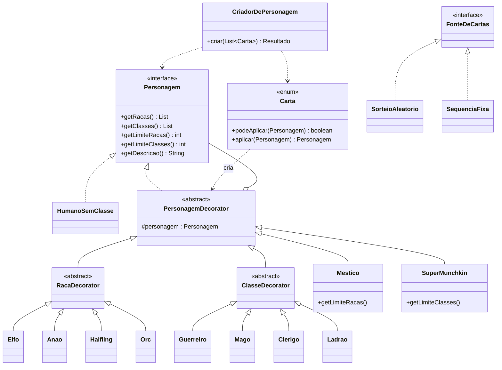

# Sistema de Criação de Personagens no Munchkin

## Padrão de projeto escolhido: **Decorator** (estrutural)

## Justificativa
- O personagem **começa como `HumanoSemClasse`** (componente concreto) e é **enriquecido dinamicamente** a cada carta aplicada. Isso é exatamente a intenção do Decorator: acrescentar responsabilidades a um objeto em tempo de execução, sem alterar sua classe.
- As cartas são sorteadas, então a combinação só é conhecida em execução. Os decorators podem ser empilhados em qualquer ordem e quantidade.
- **Sem o padrão** seria preciso uma subclasse por combinação (ElfoGuerreiro, ElfoMagoGuerreiro...) ou um grande `if/else`, o que o enunciado proíbe.
- **Extensibilidade (princípio aberto/fechado):** nova raça/classe = 1 classe decorator + 1 linha no enum `Carta`. Nada do código existente muda.
- **Cartas especiais** (`Mestico`, `SuperMunchkin`) também são decorators: não acrescentam descrição, mas alteram os limites (`getLimiteRacas()` / `getLimiteClasses()`) vistos pelo restante da cadeia.
- Cartas **excedentes** são descartadas pelo `CriadorDePersonagem`, que consulta `Carta.podeAplicar(personagem)` antes de decorar.
- Como o Mestiço/Super Munchkin pode vir em qualquer posição (Exemplos 1 e 2), o processamento é em **2 passadas**: 1ª aplica as especiais (ajusta limites), 2ª aplica raças/classes na ordem recebida.

## Diagrama de classes simplificado


## Como executar (Java 17+)
```
javac -encoding UTF-8 *.java
java Main                              # roda os 3 exemplos do enunciado + 1 sorteio
java Main ELFO MAGO ANAO MESTICO       # entrada do usuário (exatamente 4 cartas)
```
Obs.: seguindo os exemplos do enunciado, as cartas especiais não aparecem em "aplicadas" nem em "descartadas".
